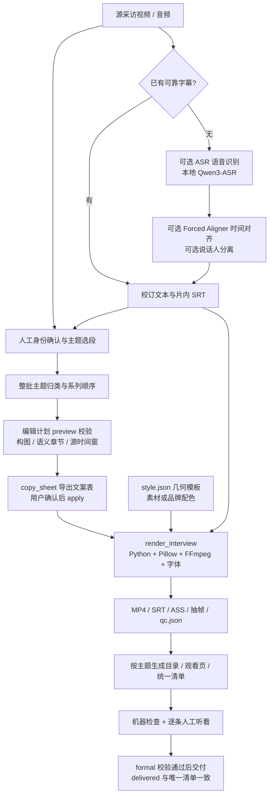

# Interview to Short Video Skill

采访 → 短视频切片：为 Codex 等能够读取 SKILL.md 的 AI 助手提供编辑流程，并附带 Python/FFmpeg 渲染工具。面向真实采访、专家对谈、播客视频，按完整意群选段，保留人物、问答和限定条件。说明以中文为主，英文目录名便于安装和分享。

**当前版本：v0.1.0 本地发布候选，尚未上传。** 这是需要人工编辑与听看的工作流，不是一键自动爆款生成器。已有字幕即可使用，不需要先部署大模型。支持单个连续片段渲染；多段拼接要先制作干净中间片并重算字幕时间。发布验证范围见 [验证报告](docs/validation.md)。

## 关系图



ASR（自动语音识别）把声音变成文字；强制对齐把文字放回时间轴；说话人分离产生声音簇，不能确认真人身份。LLM（大语言模型）助手负责协助主题与文案判断；FFmpeg 负责合成，不替代内容审阅。

## 安装

先安装 Git、Python 3.10+ 和带 libass / libx264 的 FFmpeg（含 ffprobe）。本机验证 Python 3.14；CI（自动检查）配置了 Python 3.10 与 3.12 的 Ubuntu 环境，远端运行结果需在发布时另行核对。ASR 使用独立环境，不能照搬渲染器的 Python 版本。

```bash
git clone https://github.com/lichtweiss/interview-to-short-video-skill.git
cd interview-to-short-video-skill
python3 -m venv .venv
.venv/bin/python -m pip install -r requirements.txt
.venv/bin/python scripts/doctor.py --font /your/fonts/NotoSansCJK-Regular.ttc
```

macOS 可用 `brew install ffmpeg`；Ubuntu 可用 `sudo apt-get install ffmpeg fonts-noto-cjk`。实际是否有 ass / libx264 以 doctor 输出为准。Windows 尚未验证；命令使用 POSIX shell，Windows 需自行适配路径、虚拟环境与字体。

让 Codex 发现技能，可将仓库克隆到 `~/.codex/skills/interview-to-short-video-skill`，或把该位置链接到持久保存的仓库目录，然后重开会话。不要把仓库再嵌套一层。其他助手按各自技能目录安装，尚未逐个验证。

调用名称：`$interview-to-short-video-skill`。旧本机技能名 `interview-short-video` 不是本仓库安装名；迁移时避免同时启用两个版本。

## 第一次试跑（不需要模型或真实采访）

下例生成彩条与提示音，仅验证工具链，不证明语音识别或剪辑质量；字体需自行安装。输出工作目录必须为新目录。

```bash
.venv/bin/python scripts/create_demo.py --work work/demo --font /your/fonts/NotoSansCJK-Regular.ttc --font-family 'Noto Sans CJK SC'
.venv/bin/python scripts/validate_editorial_plan.py work/demo/plan.json --stage preview --json
.venv/bin/python scripts/render_interview.py work/demo/spec.json --out work/demo/preview
.venv/bin/python -m unittest discover -s tests -v
```

查看 `preview/video.mp4`、三张抽帧与 `qc.json`。合成样例明确保留 human review 为 pending，不得作为正式采访交付。可选配色试跑：

```bash
.venv/bin/python scripts/suggest_palette.py work/demo/source.mp4 --end 2 --out work/demo/palette
```

## 真实项目

按 [SKILL.md](SKILL.md) 执行。先登记源片、主题和人物证据，再准备片内时间 SRT 与渲染规格。示例规格由 create_demo 生成，完整字段见 [生产合同](references/production.md)，文案工具见 [文案确认](references/copy.md)，状态与证据见 [编辑计划](references/editorial_plan.md)。

```bash
.venv/bin/python scripts/copy_sheet.py export /project/spec.json /project/copy.md
# 用户校订并明确确认后，才将 copy.md 中 copy-status 改为 user-confirmed。
.venv/bin/python scripts/copy_sheet.py apply /project/spec.json /project/copy.md --out /project/build/spec.json --approval "用户确认的实际消息引用"
.venv/bin/python scripts/render_interview.py /project/build/spec.json --out /project/preview
```

`画面文字编订.md` 是生产中途的文字与字幕审阅入口：表格修改固定文案和字幕字号，文档链接的 SRT 修改逐字字幕内容与时间。必须主动交付文件路径并等待用户编辑确认；只有用户明确接受初稿且授权生产，才用 `--accept-default --approval "实际授权引用"`。修改后重新编译和渲染，原 MP4 不会自动更新。

每批由编辑助手自动提出主题，再用 [主题输出工具](references/themes.md) 生成主题目录、预览页与统一清单；不固定主题数，不把单条章节当成整批主题。项目最小背景与缺失信息处理见 [项目上下文](references/project_context.md)。这部分通用公开表述仍待作者批准。

preview 校验通过只表示计划结构成立；formal 校验要等样片 QC 与实际人工审阅完成后再运行。渲染器不替你检查整个计划或确认记录；不要绕过工作流用低层工具输出冒充正式片。

## 环境、边界和发布标准

必需 / 可选依赖、Qwen 型号、替代转写软件的输入合同、CPU/GPU 边界与故障处理见 [环境说明](references/environment.md)。本仓库不打包模型、字体、真实录音、客户转写或个人路径，不自动联网、下载模型、发布成片或创建自动化。AI 助手自身若使用云服务，文本仍可能发送到其服务端。

[发布清单](docs/releasing.md) 定义以后每次分享前的检查。[CONTRIBUTING.md](CONTRIBUTING.md) 说明如何复现问题。代码与说明采用 [MIT](LICENSE)；第三方依赖、模型、字体、素材分别遵守各自许可，MIT 不授予真实采访素材的使用权。
