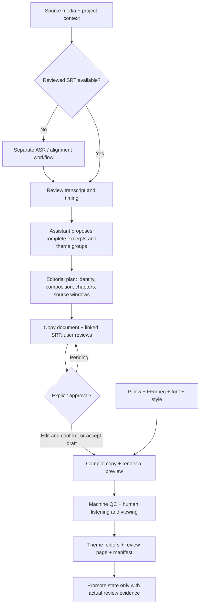

# Interview → Short Video Skill

**English** · [简体中文](README.zh-CN.md)

[](https://github.com/lichtweiss/interview-to-short-video-skill/actions/workflows/checks.yml) · [MIT](LICENSE)

Turn a long interview into short videos that preserve what was actually said—and make the batch easy to review by topic.

Selecting a striking sentence is only part of the job. A usable clip also needs the right speaker, enough context, accurate subtitles, approved on-screen copy, and a complete ending. This skill helps an AI assistant manage those decisions and provides local tools to render and organize the result.

> **Actively maintained and under iteration.** This is an early public implementation. Editorial rules, schemas, and tools may evolve. Use the validation record below to judge what is proven today; pin a commit for repeatable production.

[Try it](#try-it-without-an-asr-model) · [Workflow](#how-it-works) · [Environment](references/environment.md) · [Validation](docs/validation.md) · [Design review](docs/design-review.md)

## What you get

| Need | Result |
|---|---|
| Find coherent excerpts | A source-linked editorial plan with complete thought units and speaker evidence |
| Organize a batch | Proposed semantic themes, series order, topic folders, an HTML review page, and one manifest |
| Control words before production | A visible copy review document plus linked SRT files, followed by explicit user confirmation |
| Produce a consistent preview | A 1080×1920 MP4, SRT/ASS subtitles, overlay, sampled frames, render log, and machine QC |
| Decide what can be delivered | Separate machine checks, human listening/viewing, copy approval, and delivery states |

Use it for real interviews, expert conversations, or video podcasts when you can review the source and want a traceable editing process. An assistant proposes topics and copy; the Python scripts validate and render inputs. They do not autonomously discover meaningful clips or establish a person's identity.

**Current renderer:** one continuous source span, a 1080×1920 canvas, and 1–3 chapters. Multi-span edits need a clean intermediate video and explicit time mapping. These are implementation limits, not universal editorial rules. Internal skill instructions, detailed references, and copy-tool labels currently remain mainly in Chinese; the two landing pages are bilingual.

## What you bring

Bring the original media, permission to use it, an installed font, and either reviewed subtitles or a separately configured transcription workflow. A short project brief is enough: confirmed people/organization names, interview background, audience, publishing purpose, key terms, and public/private boundaries. Existing notes can supply these facts; a large knowledge base is not required.

The reusable layer is the editing workflow and local tooling. Your organization's facts, speaker identities, brand choices, source recordings, and permissions remain project inputs. More context improves naming and framing; it never overrides the recording. See [Project context](references/project_context.md).

## How it works



`画面文字编订.md` (on-screen copy review) controls titles, chapter labels, other fixed text, and subtitle sizing. Its linked SRT controls spoken subtitle text and timing. The user edits and confirms before production, unless they explicitly accept the first draft and authorize production. Silence is not approval. Changes to either file require re-application and re-rendering; already exported MP4s do not update themselves.

ASR means automatic speech recognition. It is an optional upstream step, not part of the renderer. The documented local route uses Qwen3-ASR-1.7B; model weights and inference environments are not bundled. Reviewed SRT from other permitted tools can also be used. Alignment places text on the timeline; diarization produces acoustic labels, not confirmed names. See [Environment and ASR](references/environment.md).

## Try it without an ASR model

Install Git, Python 3.10+, FFmpeg with `ffprobe`, `libass` and `libx264`, and a CJK-capable font. On macOS use `brew install ffmpeg`; on Ubuntu use `sudo apt-get install ffmpeg fonts-noto-cjk`.

```bash
git clone https://github.com/lichtweiss/interview-to-short-video-skill.git
cd interview-to-short-video-skill
python3 -m venv .venv
.venv/bin/python -m pip install -r requirements.txt
.venv/bin/python scripts/doctor.py --font /path/to/NotoSansCJK-Regular.ttc
.venv/bin/python scripts/create_demo.py \
  --work work/demo \
  --font /path/to/NotoSansCJK-Regular.ttc \
  --font-family 'Noto Sans CJK SC'
.venv/bin/python scripts/validate_editorial_plan.py work/demo/plan.json --stage preview --json
.venv/bin/python scripts/render_interview.py work/demo/spec.json --out work/demo/preview
```

Replace the font path and family with an installed matching font. Each output directory must be new. Open `work/demo/preview/video.mp4`, its three sampled frames, and `qc.json`. The generated bars and tone test the toolchain; they do not test ASR or real interview editing.

To export the grouped review page, add `"render_dir": "preview"` to the clip in `work/demo/plan.json`, then run:

```bash
.venv/bin/python scripts/export_review.py work/demo/plan.json --out work/review
```

Open `work/review/index.html`. It remains a preview with human review pending. [Theme export contract](references/themes.md) explains the plan/render mapping.

## Use it in an editing project

For Codex discovery, clone into `~/.codex/skills/interview-to-short-video-skill`, or link that path to a persistent checkout, then start a new session. Invoke `$interview-to-short-video-skill`. Read [SKILL.md](SKILL.md) for editing constraints; other assistant hosts have not been separately verified.

Before rendering real footage, prepare the editorial plan and per-clip specs, then hand over the copy document:

```bash
.venv/bin/python scripts/copy_sheet.py export /project/spec.json /project/画面文字编订.md
# Only after the user edits and confirms the document:
.venv/bin/python scripts/copy_sheet.py apply \
  /project/spec.json /project/画面文字编订.md \
  --out /project/build/spec.json --approval "Actual user confirmation or message reference"
.venv/bin/python scripts/render_interview.py /project/build/spec.json --out /project/preview
```

Use `--accept-default` only with actual user authorization to produce the first draft. Approval fields record a trusted user's decision; they are not authentication. The renderer is a low-level tool and does not enforce the entire editorial workflow by itself.

## Evidence and limitations

| Area | Current evidence |
|---|---|
| Renderer and file contracts | 13 automated tests cover synthetic rendering, full decode, malformed inputs, copy/SRT fingerprints, and theme export |
| Platforms | macOS arm64 / Python 3.14 locally; Ubuntu / Python 3.10 and 3.12 in GitHub Actions |
| Editorial decisions | Need human source review; no public real-interview behavioral benchmark yet |
| ASR and Windows | Not tested as part of this repository's release validation |
| Static assessment | Plugin Eval improved from 68/D to 77/C after refactoring; static budget and complexity warnings remain. This is not a measured editing success rate |

[Validation record](docs/validation.md) · [Current design diagnosis and priorities](docs/design-review.md)

## Documentation and maintenance

| Next task | Read |
|---|---|
| Install or connect transcription | [Environment and ASR](references/environment.md) |
| Prepare editorial evidence | [Editorial plan](references/editorial_plan.md) |
| Review fixed text and subtitles | [Copy control](references/copy.md) |
| Configure rendering | [Production contract](references/production.md) |
| Organize outputs | [Themes](references/themes.md) |
| Report a reproducible problem | [Contributing](CONTRIBUTING.md) · [Issues](https://github.com/lichtweiss/interview-to-short-video-skill/issues) |

Maintenance priorities are a public real-interview evaluation, stronger links between review records and actual outputs, and continued simplification of the rendering workflow. These are open work, not shipped features or a delivery schedule. Keep English and Chinese landing pages aligned when behavior changes. [Release checklist](docs/releasing.md)

The separation of reusable infrastructure from project-specific context is informed by [Yage's context-infrastructure](https://github.com/grapeot/context-infrastructure). The emphasis on source attribution and separate derived judgments also draws on [Lizheng Open Context](https://github.com/sunyuzheng/lizheng-open-context). These are design references, not dependencies or claims of endorsement.

Code and documentation use the [MIT License](LICENSE). Models, fonts, recordings, and interview participants' contributions retain their own licensing and permission requirements. Local rendering does not imply the AI assistant's text processing is offline.
