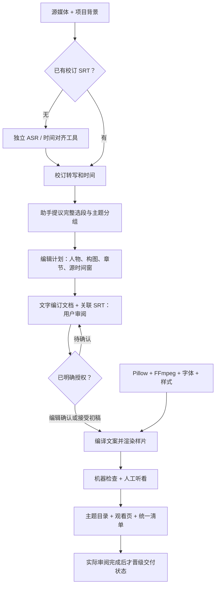

# 采访 → 短视频切片 Skill

[English](README.md) · **简体中文**

[](https://github.com/lichtweiss/interview-to-short-video-skill/actions/workflows/checks.yml) · [MIT](LICENSE)

把长采访整理成忠于原意的短片，并让整批作品按主题清楚地呈现、审阅和交付。

找到一句有吸引力的话只是起点。真正可用的片段还需要正确的人物归属、足够的上下文、准确字幕、已确认的画面文案和完整收尾。这个技能帮助 AI 助手处理这些编辑判断，并提供本地工具完成渲染与整理。

> **持续迭代与维护中。** 当前是早期公开实现，编辑规则、数据字段和工具接口仍可能调整。请根据下方验证范围判断适用性；需要复现生产时，固定使用某次提交版本。

> **转写前提：** 从原始采访开始，必须另配**独立的语音转文字模型或转写服务**，并校订字幕与时间。本技能不包含、也不直接调用语音识别模型。已有带时间轴且经过校订的 SRT 时，可以直接接入，无需再安装一套模型。下方演示预置合成字幕，跳过了 ASR。

[先试跑](#用预置字幕测试渲染) · [工作关系](#工作关系) · [环境说明](references/environment.md) · [验证记录](docs/validation.md) · [设计诊断](docs/design-review.md)

## 能得到什么

| 你的需要 | 对应产物 |
|---|---|
| 找到完整、成立的选段 | 可回到源时间窗的编辑计划，保留意群和人物证据 |
| 组织一整批作品 | AI 提议的语义主题、系列顺序、主题目录、HTML 观看页和统一清单 |
| 在生产前控制文字 | 可见的文案编订文档、关联 SRT 和明确的用户确认 |
| 输出一致的样片 | 1080×1920 MP4、SRT/ASS、画面层、抽帧、渲染日志和机器检查记录 |
| 判断是否能交付 | 分开记录机器检查、人工听看、文案确认与交付状态 |

适合能查看和听审原素材、希望保留编辑依据的真实采访、专家对谈及视频播客。AI 助手负责提议主题、选段和文案；Python 脚本负责校验与渲染输入，不能独立判断哪些话值得剪，也不能自动确认真人身份。

**当前渲染器范围：** 一个连续源片段、1080×1920 画布、1–3 个章节。多段重组需要先制作干净中间片并提供时间映射。这些是当前实现限制，不是所有采访都必须遵守的编辑规律。首页有中英文版本；技能正文、详细参考文档及文案工具标签目前仍主要使用中文。

## 你需要准备什么

准备原始媒体及使用许可、已安装的字体，以及已校订字幕或单独配置的转写工具。项目背景简短即可：已确认的人物与组织名称、采访背景、受众、发布目的、关键术语和公开边界；可直接提供已有资料，无需先建立庞大知识库。

可复用的是编辑流程与本地工具；组织事实、人物身份、品牌选择、原始素材和授权属于各自项目。背景帮助命名和表达，不能覆盖原声。详见[项目上下文](references/project_context.md)。

## 工作关系



《画面文字编订.md》控制标题、章节名称、角标等固定文字和字幕字号；关联的 SRT 控制口述字幕内容与时间。默认等待用户编辑并确认后开始生产；只有明确接受初稿并授权生产，才使用第一版。沉默不算确认。修改任一输入后需重新编译和渲染，已导出的 MP4 不会自动更新。

原始素材没有可靠字幕时，需要先通过独立 ASR（自动语音识别）完成转写。文档记录的本机路线使用 Qwen3-ASR-1.7B，不捆绑权重或推理环境；其他已获许可并校订的 SRT 也可接入。强制对齐把文字放回时间轴；说话人分离只产生声学标签，不证明真实姓名。详见[环境与 ASR](references/environment.md)。

## 用预置字幕测试渲染

安装 Git、Python 3.10+、带 `ffprobe`、`libass` 和 `libx264` 的 FFmpeg，以及支持中文的字体。macOS 可用 `brew install ffmpeg`；Ubuntu 可用 `sudo apt-get install ffmpeg fonts-noto-cjk`。

```bash
git clone https://github.com/lichtweiss/interview-to-short-video-skill.git
cd interview-to-short-video-skill
python3 -m venv .venv
.venv/bin/python -m pip install -r requirements.txt
.venv/bin/python scripts/doctor.py --font /path/to/NotoSansCJK-Regular.ttc
.venv/bin/python scripts/create_demo.py \
  --work work/demo \
  --font /path/to/NotoSansCJK-Regular.ttc \
  --font-family 'Noto Sans CJK SC'
.venv/bin/python scripts/validate_editorial_plan.py work/demo/plan.json --stage preview --json
.venv/bin/python scripts/render_interview.py work/demo/spec.json --out work/demo/preview
```

请把字体路径和字体族名称替换为本机匹配项；每个输出目录必须是新目录。查看 `work/demo/preview/video.mp4`、三张抽帧和 `qc.json`。彩条与提示音只测试工具链，不测试 ASR 或真实采访编辑能力。

如需主题观看页，在 `work/demo/plan.json` 的对应 clip 中增加 `"render_dir": "preview"`，然后运行：

```bash
.venv/bin/python scripts/export_review.py work/demo/plan.json --out work/review
```

打开 `work/review/index.html`。它仍是人工审阅待完成的预览。计划与成片如何对应，见[主题输出合同](references/themes.md)。

要一起检查文字确认、字幕修改保护、渲染与观看页命令，可运行：

```bash
.venv/bin/python tests/smoke_public_workflow.py \
  --work work/public-smoke \
  --font /path/to/NotoSansCJK-Regular.ttc \
  --font-family 'Noto Sans CJK SC'
```

此测试使用虚构确认与生成素材。[沙盒复现与独立 ASR 接入记录](docs/validation.md#sandbox-and-asr-integration)说明实际检查与未验证范围。

## 用于真实项目

让 Codex 发现技能时，可将仓库克隆到 `~/.codex/skills/interview-to-short-video-skill`，或把该路径链接到持久保存的仓库，再开启新会话。调用 `$interview-to-short-video-skill`。编辑约束见 [SKILL.md](SKILL.md)；其他助手平台尚未分别验证。

先准备编辑计划和逐片渲染规格，再交接编订文档：

```bash
.venv/bin/python scripts/copy_sheet.py export /project/spec.json /project/画面文字编订.md
# 仅在用户编辑并确认后执行：
.venv/bin/python scripts/copy_sheet.py apply \
  /project/spec.json /project/画面文字编订.md \
  --out /project/build/spec.json --approval "实际用户确认原话或消息引用"
.venv/bin/python scripts/render_interview.py /project/build/spec.json --out /project/preview
```

只有明确授权直接生产初稿时才使用 `--accept-default`。确认字段是可信工作流中的决定记录，不是身份认证；低层渲染器本身也不会强制执行整套编辑流程。

## 验证到哪里了

| 范围 | 当前证据 |
|---|---|
| 渲染与文件合同 | 13 项测试覆盖合成渲染、完整解码、非法输入、文案/SRT 指纹与主题导出 |
| 平台 | 本机 macOS arm64 / Python 3.14；GitHub Actions Ubuntu / Python 3.10、3.12 |
| 编辑判断 | 仍需人工核对原素材；尚无公开真实采访行为基准 |
| ASR 与 Windows | 已在 Apple Silicon 用缓存中的独立 Qwen3-ASR 识别生成语音，并观察到需校订的错误；全新 ASR 安装与 Windows 仍未验证 |
| 静态评估 | Plugin Eval 经重构从 68/D 提升到 77/C；仍有静态预算和复杂度告警，分数不代表实际剪辑成功率 |

[详细验证记录](docs/validation.md) · [当前设计诊断与优先级](docs/design-review.md)

## 文档与维护

| 下一步 | 入口 |
|---|---|
| 安装或接入转写 | [环境与 ASR](references/environment.md) |
| 准备编辑证据 | [编辑计划](references/editorial_plan.md) |
| 确认文案和字幕 | [文案控制](references/copy.md) |
| 配置渲染 | [生产合同](references/production.md) |
| 整理交付 | [主题输出](references/themes.md) |
| 提交可复现问题 | [贡献说明](CONTRIBUTING.md) · [Issues](https://github.com/lichtweiss/interview-to-short-video-skill/issues) |

接下来优先维护公开真实采访评估、审阅记录与实际产物的更强绑定，以及渲染器可维护性。这些是待办方向，不是已交付功能或时间承诺。行为变更时同步维护两份首页。发布检查见[发布清单](docs/releasing.md)。

可复用基础设施与项目上下文分工的思路参考了 [Yage 的 context-infrastructure](https://github.com/grapeot/context-infrastructure)；来源归属与派生判断分离的表达参考了[立正 Open Context](https://github.com/sunyuzheng/lizheng-open-context)。它们是设计参考，不是运行依赖，也不表示对本项目的背书。

代码和文档采用 [MIT](LICENSE)。模型、字体、录音和受访者发言仍遵守各自许可与授权。本地渲染不等于 AI 助手的文本处理也完全离线。
